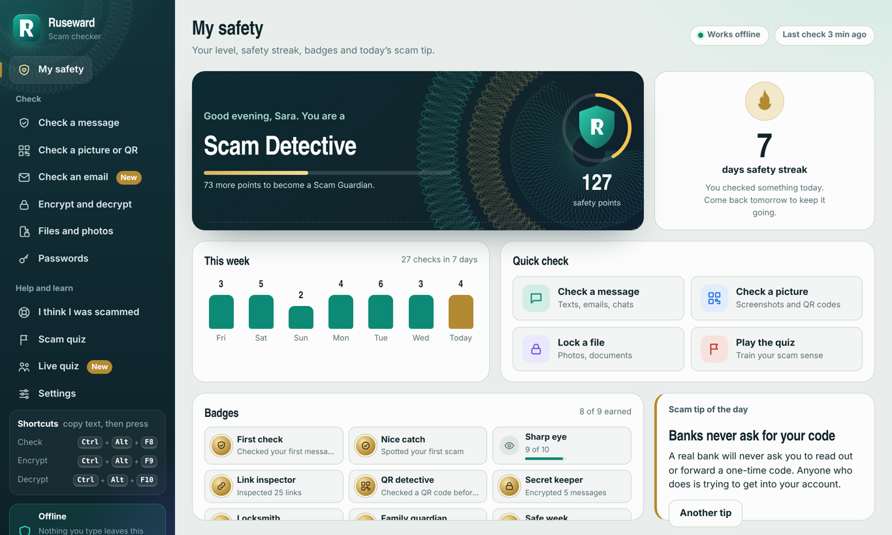
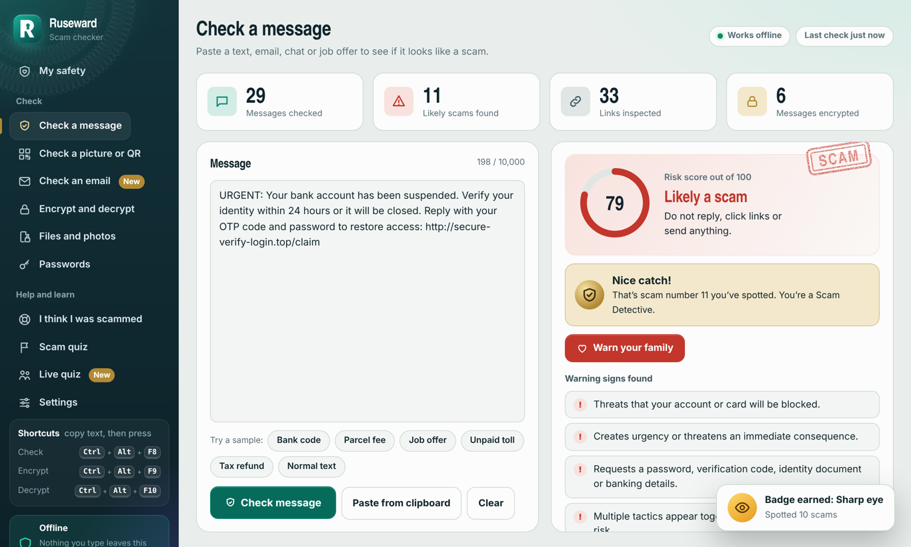
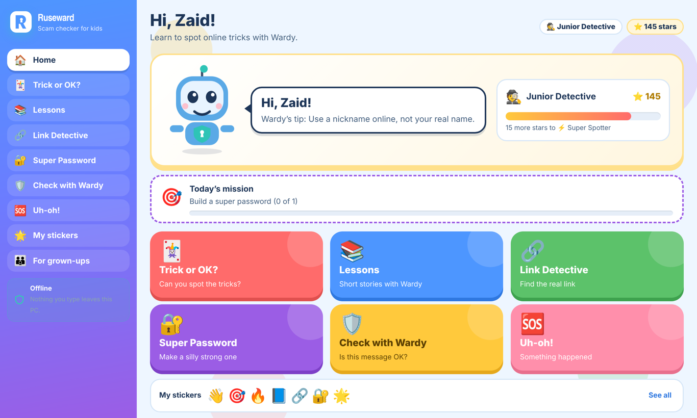
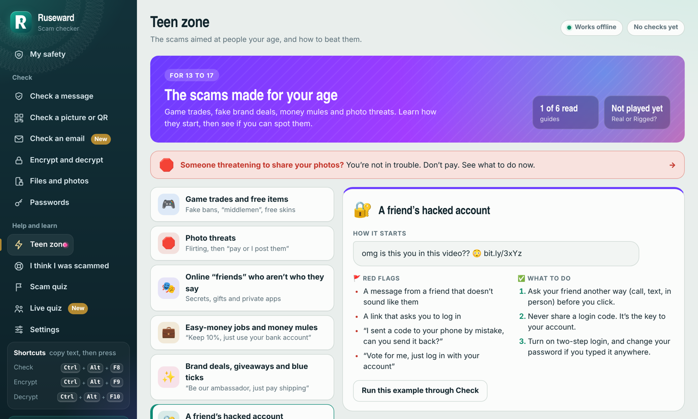

# Ruseward

**A scam checker for Windows that keeps everything on your PC.**

Paste a strange message, link or email, or drop in a screenshot or QR code, and Ruseward shows the scam signs it finds and what to do next. It also teaches scam spotting with quizzes, and it has versions for children and teenagers.



## Download

1. Go to **[Releases](../../releases/latest)** and download `Ruseward-1.0.0-windows-x64.zip`.
2. Unzip the whole folder somewhere you keep apps, for example Documents. Ruseward doesn't run from inside the zip.
3. Double-click **Ruseward.exe**.

Windows may say **"Windows protected your PC"**, because Ruseward is new and not in the Microsoft Store yet. Click **More info**, check the app name is Ruseward.exe, then click **Run anyway**.

Works on Windows 10 and 11 (64-bit). A Microsoft Store version is on the way.

## What it does

- **Check messages, links and emails.** You get a risk score, every warning sign found, and the next step to take. It knows the scams common around the world, including in the Gulf and India.
- **Check screenshots and QR codes**, including fake "scan to receive money" codes.
- **Check saved emails** for fake senders and risky attachments.
- **Lock private text and files** with a password.
- **Learn:** a scam quiz you can play alone, or host on your PC for friends and family to join from their phones.
- **Versions by age:**
  - Under 6: Wardy the robot reads everything out loud.
  - 6 to 12: games, lessons and stickers.
  - 13 to 17: the full app plus a Teen zone about fake game trades, photo threats, fake brand deals and more.



| Kids version | Teen zone |
|---|---|
|  |  |

## Privacy

- No account, no ads, no tracking.
- Nothing you check is sent to the internet.
- The live quiz and moving your profile to a new PC use only your own Wi-Fi.

Read the full [privacy policy](PRIVACY.md).

## Check your download

Each release lists a **SHA-256** fingerprint of the zip. In Windows PowerShell, run:

```
Get-FileHash .\Ruseward-1.0.0-windows-x64.zip
```

The result should match the release page exactly. If it doesn't, don't run it.

## Help

Email **rusewardsupport@gmail.com**. Ruseward's scores are estimates: when in doubt, contact the company or person yourself, using a number or website you already trust.
